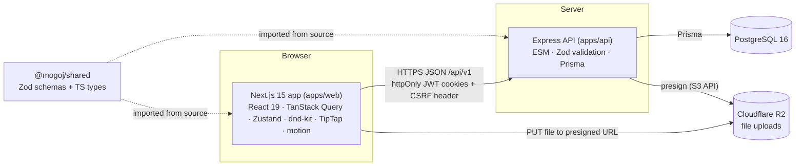
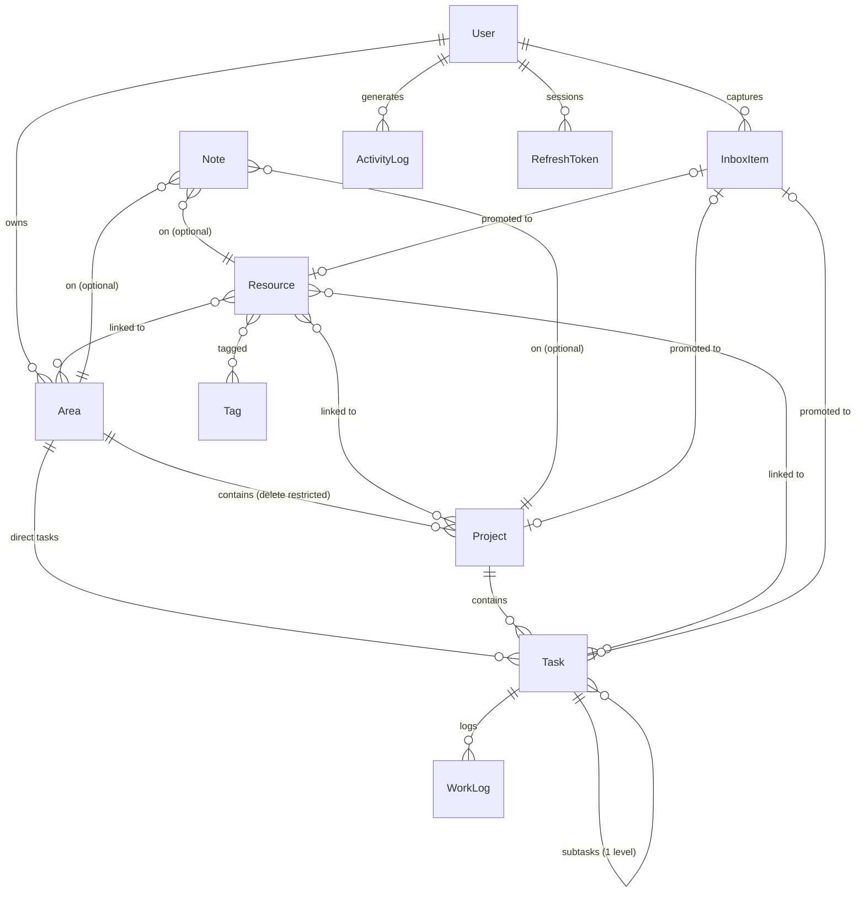
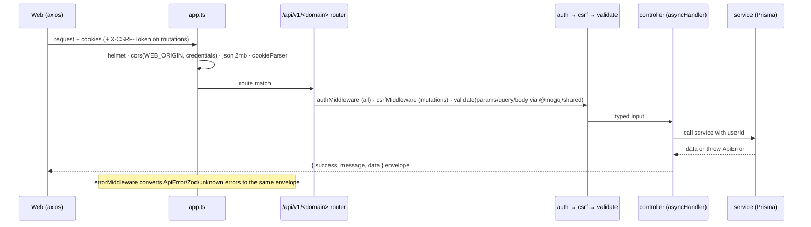
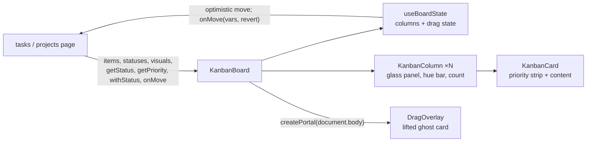

# Mogoj — Architecture

> Status: describes the codebase as of 2026-11-23 (after the "frosted graphite" redesign).
> Audience: anyone changing Mogoj, including future you. For setup commands see `README.md`; for agent rules see `CLAUDE.md`.

## 1. What Mogoj is

Mogoj is a single-user personal productivity app built on Tiago Forte's **PARA** method — **P**rojects, **A**reas, **R**esources, **A**rchive — with a GTD-style **Inbox** in front of it.

The core loop:

1. **Capture** anything into the Inbox without deciding where it belongs.
2. **Process** each inbox item into a Task, Project or Resource (or discard it).
3. **Execute** from Kanban boards, lists and the HQ dashboard.
4. **Archive** finished areas and projects so active views stay small.

Everything is scoped to the signed-in user. There is no sharing or collaboration.

## 2. System overview



| Piece | Tech | Notes |
|---|---|---|
| Monorepo | pnpm workspaces + Turborepo | `pnpm dev` / `make dev` runs web + api together |
| Web | Next.js 15 App Router (webpack), React 19, Tailwind v4 | Client-rendered app shell; data via TanStack Query |
| API | Express (ESM), Prisma 6, Zod | Thin controllers, services own queries |
| Contract | `packages/shared` | Zod schemas + enums + types, consumed from source (no build step) |
| Database | PostgreSQL 16 (Docker, host port **5433**) | Port 5433 avoids clashing with a local Homebrew Postgres on 5432 |
| Files | Cloudflare R2 (S3-compatible) | Only used for resource uploads |
| Deploy target | Vercel (web) ↔ Railway (api + Postgres) | Cross-origin cookies in production |

## 3. Repository layout

```
apps/
  api/
    prisma/schema.prisma        # data model + migrations
    src/
      app.ts                    # helmet, cors, json, cookies, /api/v1, error handling
      routes/index.ts           # mounts /api/v1/<domain>
      middlewares/              # auth, csrf, validate, error, notFound
      modules/<domain>/         # {routes,controller,service}.ts per domain
      utils/                    # ApiError, sendSuccess, asyncHandler, tokens, cookie options
  web/
    app/(auth)/                 # login, register
    app/(app)/                  # authenticated shell: HQ, inbox, tasks, projects, areas, resources, archive, settings
    app/(app)/template.tsx      # page-transition wrapper (fade + rise)
    components/<domain>/        # feature components
    components/shared/          # primitives: Button, Modal, Sheet, Select, Badge, EditableTitle, …
    hooks/use<Domain>.ts        # one TanStack Query hook file per domain
    lib/                        # api client, utils, colors, entityName, priorityBreath, tiptap, deadline
    store/useUIStore.ts         # ephemeral UI state (Zustand)
packages/
  shared/src/{schemas,types,constants}
docs/ARCHITECTURE.md            # this file
Makefile                        # `make dev`: start Postgres, stream web + api logs
```

## 4. Domain model



| Entity | Key fields | Rules |
|---|---|---|
| **Area** | name (≤100), color, icon, status `active·archived`, order | A long-running responsibility. Cannot be deleted while it has projects (`onDelete: Restrict`). |
| **Project** | name (≤150), areaId, status `active·on_hold·completed·archived`, priority, start/end dates, color, icon | Always belongs to an area. List responses add `totalTasks` / `completedTasks`. |
| **Task** | title, status `todo·in_progress·in_review·done`, priority `low·medium·high·critical`, dueDate, tags (JSON), isRecurring, order | Belongs to a project **or** directly to an area (enforced in service/Zod). Subtasks nest **one level** only. |
| **WorkLog** | taskId, body | Append-only progress notes on a task. |
| **Resource** | title, type `note·pdf·link·image`, status `open·closed`, content (TipTap JSON), url, icon | Many-to-many with projects, areas, tasks and tags. |
| **Note** | title, content (TipTap JSON) | Optionally attached to a project, area or resource. |
| **InboxItem** | title, body, type `task·project·note·idea`, status `captured·processed`, attachments | Records what it was promoted into. |
| **ActivityLog** | entityType, entityId, action `created·updated·deleted·archived·moved·completed·promoted` | Written by services on mutations; feeds the activity feed and the dashboard chart. |
| **Tag** | name, color | Used by resources. (Tasks store tags as an embedded JSON array — see §10.) |

`order` is a `Float` everywhere so items can be reordered by inserting between neighbours without renumbering.

## 5. Features

### Capture & process (Inbox)
- Quick capture box; unprocessed count shown in the sidebar (mono count) and HQ summary.
- **Process modal** turns an item into a Task, Project or Resource in one step (`POST /inbox/:id/process`), marks it processed, links it to what it became and writes a `promoted` activity entry.
- Processed items animate out of the list.

### HQ dashboard (`/`)
- Header: today's date + live summary ("4 due today · 2 overdue · 7 in inbox").
- Stat tiles with count-up animation: due today, overdue, active projects, completed this week (with change vs last week).
- **Created vs completed** chart over the last 8 weeks, computed from `ActivityLog` (`bucketThroughput` in `dashboard.service.ts`).
- Today list (tick to complete), active projects with progress bars, recent resources, recent activity.

### Tasks (`/tasks`)
- Three always-mounted views: **Kanban**, list, cards (switching never unmounts — see `AnimatedViewSwitch`).
- Filters, sort, quick add per column, subtasks, work logs, due-date badges (Today / Tomorrow / Nd overdue).
- Task detail opens as a cross-page slide-over via `useUIStore.openTaskDetail(id)`.

### Projects (`/projects`, `/projects/:id`)
- Portfolio metrics, Kanban by project status, list and card views.
- Project page: inline-editable name, icon + color picker, status, priority, dates, its own task board, notes and linked resources.

### Areas (`/areas`, `/areas/:id`)
- Area grid; area dashboard with its projects, direct tasks and resources; inline-editable name.

### Resources (`/resources`, `/resources/:id`)
- Rich-text editor (TipTap) with text colors and highlights tuned for dark mode.
- Links, PDFs and images; file uploads go **browser → R2** via a presigned URL from `POST /resources/upload-url`.
- Tags, linked notes, links to projects / areas / tasks.

### Archive (`/archive`)
- Archived areas and projects, kept out of active views.

### Cross-cutting
- **⌘K command palette**: jump to any page or search tasks, projects, areas and resources.
- **Kanban priority strip**: every card carries a colored strip above it (Low / Medium / High priority / Critical).
- **Critical "breathing"**: critical tags breathe everywhere they appear (strip, labels, priority dropdowns): their red tint deepens and text brightens while a red glow swells around them, on one 2.4s timeline. They stop once done/completed/archived. Rule: `lib/priorityBreath.ts`; styles: `.breathe-critical` in `app/globals.css`.
- **Icon picker**: Lucide icons, emoji or uploaded image; 24 dark-safe colors plus a custom color.
- **Failure feedback**: optimistic Kanban moves revert and show an error toast when the API rejects them.
- Settings: profile (name, avatar).

## 6. How it operates

### 6.1 Request lifecycle (API)



Every service query filters by `userId`, which is the tenancy boundary.

### 6.2 Authentication

- **Access token**: short-lived JWT in an httpOnly cookie.
- **Refresh token**: rotated on every refresh; stored server-side **hashed** (`RefreshToken.tokenHash`) with `expiresAt` / `revokedAt`.
- **CSRF**: double-submit cookie `mogoj_csrf_token`; the web client echoes it as `X-CSRF-Token` on mutating requests.
- **Silent refresh**: `apps/web/lib/api.ts` catches a 401, calls `/auth/refresh` once (concurrent 401s share one refresh promise), then retries the original request.
- **Production**: cookies become `SameSite=None; Secure` for the cross-origin Vercel ↔ Railway setup.

### 6.3 Web data layer

- Server state lives **only** in TanStack Query. One hook file per domain (`useTasks`, `useProjects`, …).
- Mutations invalidate by domain key prefix; task mutations also invalidate `["projects"]` because project views embed task counts.
- Zustand (`useUIStore`) holds only ephemeral UI state: which detail drawer is open, the inbox process modal.
- The shared package is the contract: change a shape in `packages/shared` first, then the API service, then the hooks/components.

### 6.4 Kanban (generic board)



- The board is generic over the item type; tasks and projects reuse it with different `statuses` / `visuals` (`kanbanColumns.ts`).
- Moves are **optimistic**: the UI updates immediately and `onMove` gets a `revert` callback if the API call fails.
- The `DragOverlay` is portaled to `<body>` because glass panels use `backdrop-filter` (and the page transition uses `transform`), either of which would otherwise offset the fixed-position drag ghost.

### 6.5 Inbox processing

`processInboxItem` in `inbox.service.ts` branches on the chosen target, creates the Task / Project / Resource, sets `status: processed`, `processedAt` and the matching `promotedTo*Id`, and writes a `promoted` activity entry. The unique `promotedTo*Id` columns guarantee an item is promoted at most once per target type.

### 6.6 Dashboard aggregation

`GET /dashboard` runs its queries in parallel: tasks due today or earlier (not done), active projects with task counts, recent resources, recent activity, unprocessed inbox count, active project count, and task `created` / `completed` activity for the last 8 weeks bucketed by Monday-start week (server local time).

### 6.7 Search

`GET /search?q=` runs a case-insensitive substring match (`ILIKE`) on task titles and project / area / resource names, capped per type. The ⌘K palette shows results grouped by type.

### 6.8 File uploads

The browser asks the API for a presigned `PUT` URL (`POST /resources/upload-url`), uploads the file directly to R2, then saves the resulting public URL on the resource. File bytes never pass through the API.

## 7. Frontend architecture

### 7.1 Shell and routing
- Route groups: `(auth)` for login/register, `(app)` for the authenticated shell (`AppShell`: floating glass sidebar + header, scrolling main).
- `(app)/template.tsx` re-mounts per navigation and plays one short fade-and-rise.
- Cross-page detail views (task, project, resource) are slide-overs driven by the UI store, not routes.

### 7.2 Design system ("frosted graphite", dark only)
- Tokens in `app/globals.css`: neutral graphite surfaces, three text roles, one accent (`--brand #7c9cff`), priority hues `--prio-*`.
- Two blurred surfaces only: `glass` (chrome, page panels) and `glass-overlay` (modals, sheets, menus, toasts). Repeated cards use translucent `bg-card` **without** blur for performance.
- Spacing on a true 4px grid (`--spacing: 4px`, because the root font size is 14px).
- Type: Geist + Geist Mono (counts, dates, meta) via `next/font`.
- Logo mark: four PARA quadrants with Projects lit (`components/layout/MogojMark.tsx`).

### 7.3 Motion
- One curve (`--ease-soft`) and three durations (`--dur-fast/base/slow`); `prefers-reduced-motion` disables animation globally.
- `motion` library for things CSS can't do: sliding nav pill (`layoutId`), page transition, list exit animations, number tweens.
- Kanban drag: lift, no-overshoot drop, column highlight in its own hue.

## 8. API reference

All routes are under `/api/v1`, require auth except `register` / `login` / `refresh`, and return `{ success, message, data }`.

| Domain | Endpoints |
|---|---|
| auth | `POST /register` · `POST /login` · `POST /logout` · `POST /refresh` · `GET /me` · `PATCH /profile` |
| areas | `GET /` · `POST /` · `GET /:id` · `GET /:id/dashboard` · `PATCH /:id` · `DELETE /:id` |
| projects | `GET /` · `POST /` · `GET /:id` · `GET /:id/kanban` · `PATCH /:id` · `DELETE /:id` |
| tasks | `GET /` · `POST /` · `GET /:id` · `PATCH /:id` · `DELETE /:id` · `GET /:id/subtasks` · `POST /:id/subtasks` · `POST /:id/worklogs` |
| resources | `GET /` · `POST /` · `POST /upload-url` · `GET /:id` · `PATCH /:id` · `DELETE /:id` |
| notes | `GET /` · `POST /` · `GET /:id` · `PATCH /:id` · `DELETE /:id` |
| inbox | `GET /` · `POST /` · `PATCH /:id` · `DELETE /:id` · `POST /:id/process` |
| dashboard | `GET /` |
| search | `GET /?q=` |

## 9. Configuration, running and verification

**Environment**
- `apps/api/.env`: `DATABASE_URL` (port 5433), `PORT=4000`, `NODE_ENV`, `WEB_ORIGIN=http://localhost:3000`, `JWT_ACCESS_SECRET`, `JWT_REFRESH_SECRET`, `ACCESS_TOKEN_TTL`, `REFRESH_TOKEN_TTL_DAYS`, `CSRF_SECRET`, and five `R2_*` values (validated at startup by `src/config/env.ts`).
- `apps/web/.env.local`: `NEXT_PUBLIC_API_URL=http://localhost:4000/api/v1`.

**Running**
- `make dev`: starts Postgres in Docker (detached), then streams web (:3000) and api (:4000) logs together. Ctrl+C stops both apps; Postgres keeps running.
- First run: `pnpm db:migrate`, optionally `pnpm db:seed` (demo login `demo@mogoj.app` / `password123`).

**Verification**
- `pnpm typecheck` and `pnpm lint` (zero warnings allowed) across all workspaces.
- Focused unit tests using Node's built-in runner (no framework installed):
  ```bash
  W="$PWD/apps/web/lib"
  pnpm --filter @mogoj/api exec tsx --test "$W/colors.test.ts" "$W/entityName.test.ts" "$W/priorityBreath.test.ts"
  ```
- Don't run `next build` while `make dev` is running: both write `apps/web/.next`, and the build breaks the dev server's chunks.

## 10. Known limitations and improvement roadmap

Grouped by priority. Each item notes what exists today, so it can be checked against the code.

### P0: safety and correctness
| # | Today | Improvement |
|---|---|---|
| 1 | **No rate limiting** on any route, including `POST /auth/login`. | Add `express-rate-limit` (strict on auth routes, looser globally) and progressive delay on failed logins. |
| 2 | **No password reset or email verification** (auth exposes only register / login / logout / refresh / me / profile). | Add reset-token flow (hashed, short-lived, single-use, like refresh tokens) plus a transactional email provider. |
| 3 | **No automated test suite or CI.** Only three small `node:test` files. | Add Vitest for web + shared, API integration tests against a throwaway Postgres (services + routes), Playwright for the critical flows (login, inbox process, Kanban drag), and a GitHub Actions pipeline running typecheck, lint and tests. |
| 4 | **Logging is `console` only**; no request IDs or error tracking. | Structured logger (pino) with request IDs, plus an error tracker (e.g. Sentry) on web and api. |

### P1: scale and data consistency
| # | Today | Improvement |
|---|---|---|
| 5 | **List endpoints don't paginate** (tasks, projects, resources, notes, inbox return everything; only search and dashboard use `take`). | Cursor pagination using the existing `order` / `createdAt` indexes; infinite scroll on list views. |
| 6 | **Tags are modelled twice**: a `Tag` table for resources, an embedded JSON array on tasks. | Use one `Tag` model with relations to tasks and resources so tags can be renamed, recolored and filtered everywhere. |
| 7 | **`isRecurring` is stored but nothing acts on it**: no recurrence rule, no next-instance generation. | Add a recurrence rule (RRULE-style) and create the next instance when a recurring task completes. |
| 8 | **Search is substring `ILIKE` on titles/names only**; doesn't look inside resource or note content. | Postgres full-text search (`tsvector` + GIN index) over titles and TipTap plain text, with ranking. |
| 9 | **Dashboard weeks use server local time**; users have no timezone. `User.preferences` (JSON) exists but is unused for this. | Store the user's timezone in `preferences` and bucket "today" / weeks in it. |
| 10 | **Work logs are append-only** (`POST /:id/worklogs` only). | Edit/delete endpoints, plus optional time-spent per log to enable time reporting. |

### P2: product
| # | Today | Improvement |
|---|---|---|
| 11 | **Desktop only**: sidebar is fixed at 256px; `sidebarOpen` / `toggleSidebar` exist in `useUIStore` but nothing uses them. | Collapsible sidebar and a mobile drawer, Kanban horizontal snap on small screens, then a PWA with offline capture. |
| 12 | **Capture only inside the app.** | Global quick-capture shortcut (⌘⇧I), share-sheet / email-to-inbox, browser extension for links. |
| 13 | **No reminders or notifications.** | Due-date reminders (email/push) for today and overdue, plus a weekly review digest. That last one fits PARA's weekly-review habit. |
| 14 | **Dashboard has no calendar.** It only receives tasks due today or earlier. | Add an upcoming-tasks range to `/dashboard` and a mini calendar of due dates. |
| 15 | **Archive covers areas and projects only.** | Archive and restore resources too, with "archived on" dates and bulk restore. |
| 16 | **Dark theme only.** | Light theme from the same token set (surfaces and text roles invert; priority hues re-tuned). |

### P3: engineering polish
| # | Today | Improvement |
|---|---|---|
| 17 | `motion` is imported in full rather than through its lazy-loading API. | Switch to `LazyMotion` + `m` components with `domMax`. |
| 18 | Glass blur cost unmeasured on low-end hardware. | Lighthouse / performance traces on the Kanban page; fall back to solid surfaces via `@supports not (backdrop-filter: blur())` or a reduced-transparency setting. |
| 19 | Next.js 15.5 shows as outdated in the dev overlay. | Plan an upgrade once tests exist to catch regressions. |
